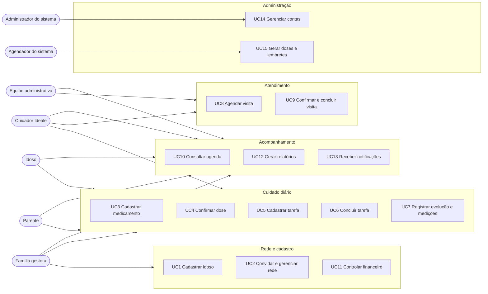
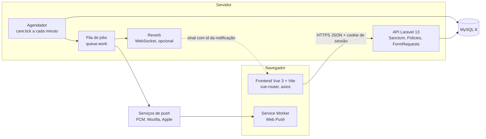
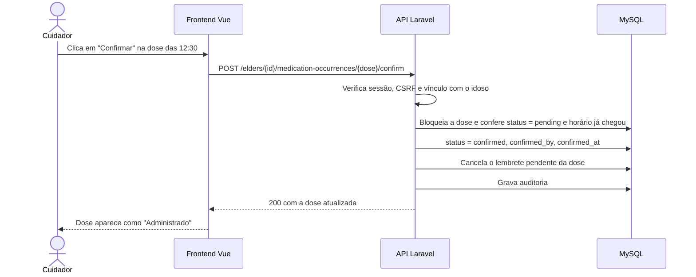
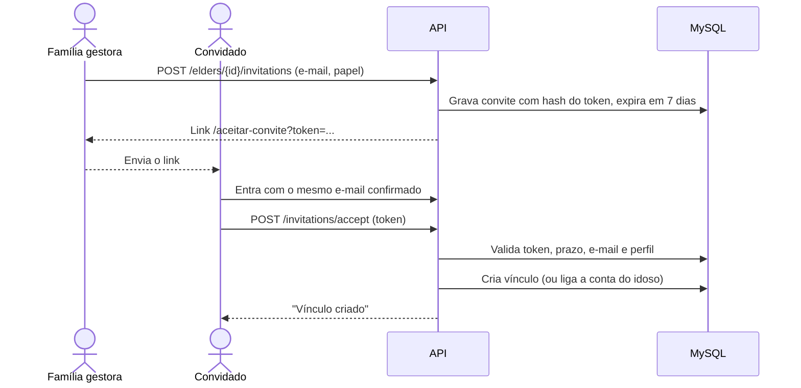
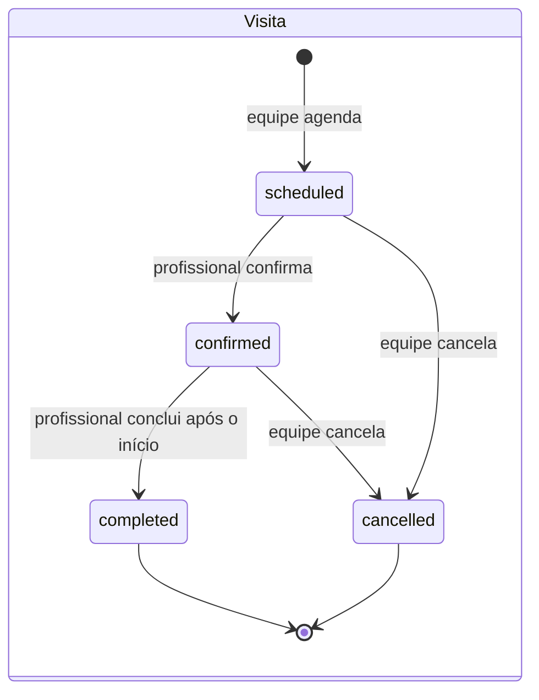
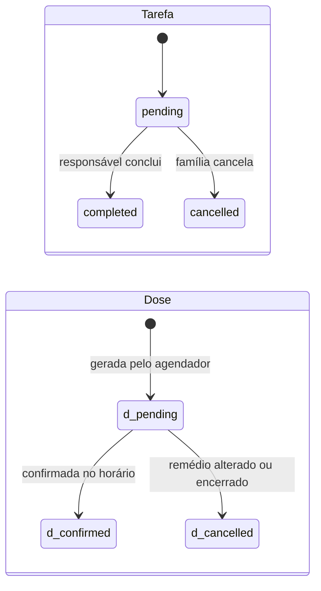
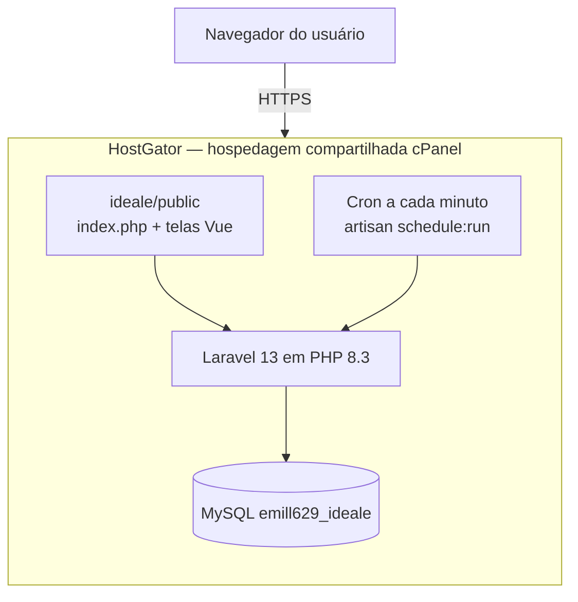

# Ideale Home Care — Documentação da aplicação

Projeto de Engenharia de Software — grupo: Emilly Eduarda Da Silva Madureira, Pedro Henrique Dal Posolo Ida, Renato Gabriel Matheus e Lucas Yuri Campos Paes de Barros.

Sumário: [1. Contexto](#1-contexto) · [2. Requisitos](#2-requisitos) · [3. Casos de uso](#3-atores-e-casos-de-uso) · [4. Arquitetura](#4-arquitetura) · [5. Modelo do banco de dados](#5-modelo-do-banco-de-dados) · [6. Sequência](#6-diagramas-de-sequência) · [7. Estados](#7-diagramas-de-estados) · [8. Implantação](#8-implantação) · [9. Validação](#9-validação)

## 1. Contexto

**Cliente:** Ideale Home Care, empresa de cuidado domiciliar de idosos.

**Problema:** família, cuidadores e coordenação trocavam informações por mensagens, cadernos e de memória. Isso levava a doses esquecidas ou repetidas, troca de turno sem contexto, família sem visão do dia a dia do idoso e gastos espalhados.

**Por que o problema importa:**

| Dado | Fonte |
|---|---|
| 32,1 milhões de pessoas com 60 anos ou mais (15,6% da população), 56% a mais que em 2010 | IBGE, Censo Demográfico 2022 |
| Idosos serão 37,8% da população em 2070 | IBGE, Projeções da População, revisão 2024 |
| 93% dos idosos usam ao menos um medicamento contínuo; 18% usam cinco ou mais | PNAUM — Ramos et al., Rev. Saúde Pública 2016;50(supl 2):9s |
| 30,8% das pessoas com doença crônica têm baixa adesão ao tratamento | PNAUM — Tavares et al., Rev. Saúde Pública 2016;50(supl 2):10s |

**Levantamento de requisitos:** informações passadas por funcionários da empresa sobre a rotina de cuidado, os papéis envolvidos e as dificuldades do dia a dia.

**Solução:** uma plataforma web em que família, cuidadores e equipe da Ideale trabalham sobre o mesmo histórico, com permissões por perfil e por idoso.

## 2. Requisitos

### 2.1 Requisitos funcionais

| ID | Requisito | Perfis |
|---|---|---|
| RF01 | Cadastrar conta familiar com confirmação de e-mail; entrar, sair e recuperar senha. | Todos |
| RF02 | Cadastrar e editar idosos (nome, nascimento, fuso horário, informações médicas). | Família gestora |
| RF03 | Convidar pessoas por e-mail para a rede de um idoso (parente, equipe Ideale ou o próprio idoso); listar, revogar convites e remover acessos. | Família gestora |
| RF04 | Cadastrar medicamentos com dosagem, período e vários horários por dia. | Família |
| RF05 | Gerar automaticamente as doses de cada dia a partir dos horários cadastrados. | Sistema |
| RF06 | Confirmar a administração de uma dose, registrando quem confirmou e quando. | Família, cuidador, idoso (próprias) |
| RF07 | Cadastrar tarefas com data, hora e responsáveis; concluir e cancelar. | Família (cria); responsável, cuidador, idoso (conclui) |
| RF08 | Registrar observações do dia (diário) com etiquetas, sem apagar o registro original (retificação vinculada). | Família, cuidador |
| RF09 | Registrar medições de pressão arterial, glicemia e temperatura. | Família, cuidador |
| RF10 | Agendar, reagendar e cancelar visitas de profissionais, sem sobreposição de horário do mesmo profissional. | Equipe administrativa |
| RF11 | Confirmar e concluir visitas; registrar leitura do diário antes do atendimento. | Cuidador |
| RF12 | Exibir agenda diária unificada (remédios, tarefas, visitas e eventos) por idoso e por profissional. | Todos com vínculo |
| RF13 | Cadastrar eventos da família, contatos de emergência e escala de responsáveis. | Família gestora |
| RF14 | Gerar lembretes e notificações de remédios e visitas; central de avisos com leitura; aviso no navegador (Web Push) e em tempo real (opcional). | Sistema |
| RF15 | Registrar receitas e despesas do cuidado, com status pago/pendente. | Família |
| RF16 | Gerar relatórios por período e tipo, com exportação em CSV e impressão. | Todos com vínculo |
| RF17 | Painel global somente leitura e suspensão/reativação de contas. | Administrador do sistema |

### 2.2 Requisitos não funcionais

| ID | Requisito |
|---|---|
| RNF01 | Aplicação web responsiva, em português do Brasil. |
| RNF02 | Autenticação por sessão com cookie seguro e proteção CSRF (Laravel Sanctum). |
| RNF03 | Autorização verificada no servidor em toda operação, por perfil global e por vínculo com cada idoso. |
| RNF04 | Informações médicas e inscrições de push gravadas criptografadas. |
| RNF05 | Datas e horas em ISO 8601 com fuso; persistência em UTC; exibição no fuso do idoso. |
| RNF06 | Edições concorrentes protegidas por versão do registro (conflito retorna 409). |
| RNF07 | Requisições de escrita idempotentes (cabeçalho `Idempotency-Key`). |
| RNF08 | Auditoria de ações sensíveis e de consultas do administrador global. |
| RNF09 | Limite de requisições por usuário e por IP (rate limiting). |
| RNF10 | API documentada em OpenAPI 3.1, com erros padronizados e `request_id`. |
| RNF11 | Executar em PHP 8.3+ e MySQL 8, inclusive em hospedagem compartilhada com cPanel. |
| RNF12 | Testes automatizados no GitHub Actions a cada push. |

### 2.3 Regras de negócio

- RN01 — A equipe da Ideale só acessa idosos cuja família enviou convite; não há acesso global.
- RN02 — Somente o gestor da rede convida, revoga convites e remove acessos. Convites expiram em 7 dias.
- RN03 — Uma tarefa só pode ser concluída pelo responsável, pelo profissional vinculado ou pelo próprio idoso.
- RN04 — A dose só pode ser confirmada a partir do seu horário.
- RN05 — O administrador do sistema consulta, mas não altera registros de cuidado.
- RN06 — Inativar um idoso preserva o histórico e bloqueia novas operações e avisos.

## 3. Atores e casos de uso

Permissões por caso de uso (detalhe do diagrama acima):

| Caso de uso | Gestor | Parente | Idoso | Cuidador | Equipe adm. | Adm. sistema |
|---|:-:|:-:|:-:|:-:|:-:|:-:|
| UC1 Cadastrar idoso | Sim | Não | Não | Não | Não | Não |
| UC2 Convidar e gerenciar rede | Sim | Não | Não | Não | Não | Não |
| UC3 Cadastrar medicamento | Sim | Sim | Não | Não | Não | Não |
| UC4 Confirmar dose | Sim | Sim | Própria | Sim | Não | Não |
| UC5 Cadastrar tarefa | Sim | Sim | Não | Não | Não | Não |
| UC6 Concluir tarefa | Se responsável | Se responsável | Própria | Sim | Não | Não |
| UC7 Registrar evolução e medições | Sim | Sim | Não | Sim | Não | Não |
| UC8 Agendar visita | Não | Não | Não | Não | Sim | Não |
| UC9 Confirmar e concluir visita | Não | Não | Não | Própria | Sim | Não |
| UC10 Consultar agenda | Sim | Sim | Própria | Sim | Sim | Leitura |
| UC11 Controlar financeiro | Sim | Sim | Não | Não | Não | Não |
| UC12 Gerar relatórios | Sim | Sim | Não | Sim | Sim | Leitura |
| UC13 Receber notificações | Sim | Sim | Sim | Sim | Sim | Sim |
| UC14 Gerenciar contas | Não | Não | Não | Não | Não | Sim |

| Caso de uso | Descrição resumida |
|---|---|
| UC1 Cadastrar idoso | O familiar informa nome, nascimento, fuso e informações médicas; torna-se gestor da rede. |
| UC2 Convidar e gerenciar rede | O gestor informa e-mail e papel (parente, equipe ou idoso); o sistema gera um link que expira em 7 dias; o convidado entra com o mesmo e-mail confirmado e aceita. |
| UC4 Confirmar dose | No horário, quem administra confirma a dose; o sistema grava autor e instante e cancela o lembrete pendente. |
| UC6 Concluir tarefa | O responsável marca a tarefa como concluída; a conclusão é única e registra o autor. |
| UC8 Agendar visita | A equipe administrativa escolhe profissional e horário; o sistema recusa sobreposição com outra visita do mesmo profissional. |
| UC9 Confirmar e concluir visita | O profissional confirma a visita agendada e, após o início, conclui o atendimento. |
| UC15 Gerar doses e lembretes | A cada minuto, o agendador gera as doses dos próximos 7 dias e materializa lembretes e notificações. |

## 4. Arquitetura

- **Frontend** (`frontend/`): SPA com 18 telas; o menu muda conforme o perfil.
- **Backend** (`backend/`): API REST versionada em `/api/v1` (69 operações), regras de acesso em `app/Services/CareAccess.php`, serviços de domínio em `app/Services`.
- **Processamento assíncrono:** `care:tick` gera doses, materializa lembretes e despacha entregas de push e tempo real, com até cinco tentativas e espera crescente.

## 5. Modelo do banco de dados

```mermaid
erDiagram
    USERS ||--o{ CARE_MEMBERSHIPS : participa
    ELDERS ||--o{ CARE_MEMBERSHIPS : tem
    USERS |o--o| ELDERS : "conta do idoso"
    ELDERS ||--o{ CARE_INVITATIONS : recebe
    USERS ||--o| PROFESSIONALS : "é"
    ELDERS ||--o{ TASKS : tem
    TASKS }o--o{ USERS : "responsáveis (task_user)"
    TASKS ||--o| TASK_COMPLETIONS : "concluída em"
    ELDERS ||--o{ MEDICATIONS : usa
    MEDICATIONS ||--o{ MEDICATION_SCHEDULES : "horários"
    MEDICATION_SCHEDULES ||--o{ MEDICATION_OCCURRENCES : gera
    ELDERS ||--o{ OBSERVATIONS : "diário"
    OBSERVATIONS |o--o{ OBSERVATIONS : retifica
    ELDERS ||--o{ MEASUREMENTS : "medições"
    ELDERS ||--o{ VISITS : recebe
    PROFESSIONALS ||--o{ VISITS : realiza
    VISITS ||--o{ OBSERVATION_READS : "leituras"
    OBSERVATIONS ||--o{ OBSERVATION_READS : "lida em"
    ELDERS ||--o{ FAMILY_EVENTS : agenda
    ELDERS ||--o{ EMERGENCY_CONTACTS : contatos
    EMERGENCY_CONTACTS ||--o{ CARE_SHIFTS : escala
    ELDERS ||--o{ REMINDERS : lembretes
    REMINDERS ||--o{ CARE_NOTIFICATIONS : notifica
    USERS ||--o{ CARE_NOTIFICATIONS : recebe
    USERS ||--o{ PUSH_SUBSCRIPTIONS : dispositivos
    CARE_NOTIFICATIONS ||--o{ PUSH_DELIVERIES : envios
    PUSH_SUBSCRIPTIONS ||--o{ PUSH_DELIVERIES : recebe
    CARE_NOTIFICATIONS ||--o| REALTIME_DELIVERIES : sinal
    USERS ||--o{ FINANCE_ENTRIES : lança
    USERS ||--o{ AUDIT_LOGS : registra

    USERS {
        bigint id PK
        string name
        string email UK
        string phone
        string role "family | elder | ideale_admin | ideale_professional | system_admin"
        boolean active
        timestamp email_verified_at
    }
    ELDERS {
        bigint id PK
        bigint user_id FK "conta do idoso (opcional)"
        bigint created_by FK
        string name
        date birth_date
        text medical_information "criptografado"
        string timezone
        boolean active
        int version
    }
    CARE_MEMBERSHIPS {
        bigint id PK
        bigint elder_id FK
        bigint user_id FK
        string role "manager | relative | team"
        boolean active
    }
    CARE_INVITATIONS {
        bigint id PK
        bigint elder_id FK
        string email
        string role "relative | team | elder"
        char token_hash UK
        timestamp expires_at
        timestamp accepted_at
        timestamp revoked_at
    }
    PROFESSIONALS {
        bigint id PK
        bigint user_id FK
        string specialty
        boolean active
    }
    TASKS {
        bigint id PK
        bigint elder_id FK
        string title
        text description
        timestamp due_at
        string status "pending | completed | cancelled"
        int version
    }
    TASK_COMPLETIONS {
        bigint id PK
        bigint task_id FK
        bigint user_id FK
        timestamp completed_at
    }
    MEDICATIONS {
        bigint id PK
        bigint elder_id FK
        string name
        string dosage
        text instructions
        date starts_on
        date ends_on
        boolean active
        int version
    }
    MEDICATION_SCHEDULES {
        bigint id PK
        bigint medication_id FK
        string local_time "HH:mm"
        string timezone
        string dosage
        timestamp effective_at
        boolean active
    }
    MEDICATION_OCCURRENCES {
        bigint id PK
        bigint medication_schedule_id FK
        timestamp scheduled_at
        date local_date
        string status "pending | confirmed | cancelled"
        bigint confirmed_by FK
        timestamp confirmed_at
    }
    OBSERVATIONS {
        bigint id PK
        bigint elder_id FK
        bigint user_id FK
        text text
        json tags
        timestamp occurred_at
        bigint corrects_id FK
    }
    MEASUREMENTS {
        bigint id PK
        bigint elder_id FK
        bigint user_id FK
        string type "blood_pressure | glucose | temperature"
        decimal value
        decimal secondary_value
        string unit
        timestamp measured_at
    }
    VISITS {
        bigint id PK
        bigint elder_id FK
        bigint professional_id FK
        string specialty
        datetime starts_at
        datetime ends_at
        string status "scheduled | confirmed | completed | cancelled"
        int version
    }
    REMINDERS {
        bigint id PK
        bigint elder_id FK
        string source_type "medication | visit"
        bigint source_id
        timestamp due_at
        string status "pending | processed | cancelled"
    }
    CARE_NOTIFICATIONS {
        bigint id PK
        bigint user_id FK
        bigint reminder_id FK
        timestamp read_at
    }
    FINANCE_ENTRIES {
        bigint id PK
        bigint user_id FK
        string description
        decimal amount
        string type "income | expense"
        string category
        date due_date
        string status "pending | paid"
    }
```

### Dicionário resumido

| Tabela | Finalidade |
|---|---|
| `users` | Contas de acesso e perfil global. |
| `elders` | Idosos acompanhados; `user_id` liga a conta do próprio idoso, quando existe. |
| `care_memberships` | Vínculo de cada pessoa com cada idoso: gestor, parente ou equipe. |
| `care_invitations` | Convites por e-mail; o token é guardado apenas como hash. |
| `professionals` | Dados profissionais (especialidade) das contas da equipe. |
| `tasks`, `task_user`, `task_completions` | Tarefas, responsáveis e conclusão única com autor. |
| `medications`, `medication_schedules`, `medication_occurrences` | Remédio, horários vigentes e doses geradas por dia, com confirmação. |
| `observations`, `observation_reads` | Diário de evolução e registro de leitura pelo profissional antes da visita. |
| `measurements` | Pressão, glicemia e temperatura. |
| `visits` | Atendimentos de profissionais com transições de estado. |
| `family_events` | Compromissos da família (consultas, eventos). |
| `emergency_contacts`, `care_shifts` | Contatos de emergência e escala de quem responde em cada período. |
| `reminders`, `care_notifications` | Lembretes gerados pelo agendador e a caixa de notificações de cada usuário. |
| `push_subscriptions`, `push_deliveries`, `realtime_deliveries` | Dispositivos inscritos e entregas com tentativas. |
| `finance_entries` | Receitas e despesas da conta. |
| `audit_logs` | Auditoria de ações e consultas sensíveis. |
| `idempotency_requests` | Respostas guardadas para repetir requisições de escrita sem duplicar. |

Além delas, o Laravel usa `sessions`, `cache`, `jobs`, `failed_jobs` e `password_reset_tokens`.

## 6. Diagramas de sequência

### Confirmar uma dose

### Convidar alguém para a rede

## 7. Diagramas de estados

## 8. Implantação

Passo a passo de publicação: [backend/docs/HOSTGATOR.md](../backend/docs/HOSTGATOR.md). Operação, filas, Reverb e backup: [backend/docs/OPERACAO.md](../backend/docs/OPERACAO.md). Contrato da API: [backend/API.md](../backend/API.md) e [OpenAPI](../backend/docs/openapi.json).

## 9. Validação

- Suíte automatizada: 60 testes de funcionalidade (57 em SQLite e 3 de concorrência exclusivos de MySQL), cobrindo perfis, isolamento entre redes, convites, versões, remédios, diário, fusos, agenda, visitas, notificações e financeiro.
- Execução em PHP 8.3 e 8.5; GitHub Actions roda testes do backend e build do frontend a cada push.
- Ensaios manuais: cadastro, confirmação de e-mail, login, cuidados, visitas, escalas, revogação, recuperação de senha, tempo real e backup/restauração (ver [backend/docs/ENTREGA.md](../backend/docs/ENTREGA.md)).
- Validação com o cliente e publicação em domínio próprio são os próximos passos.
